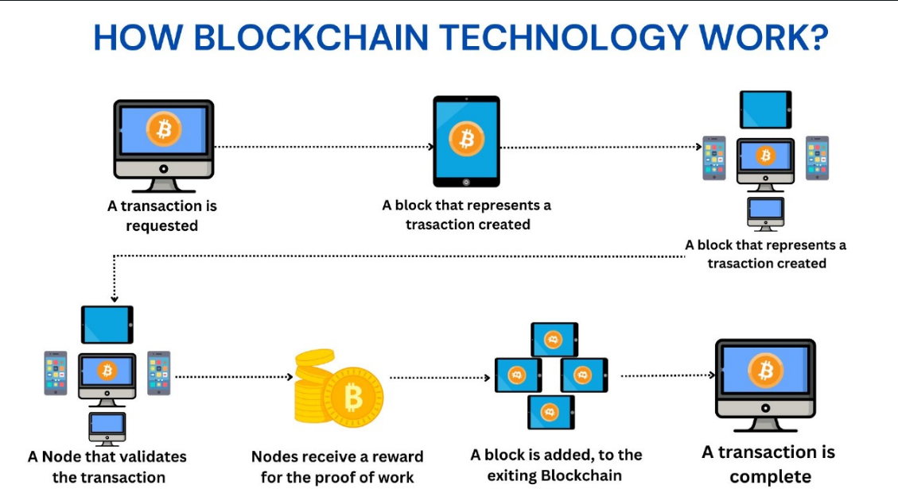
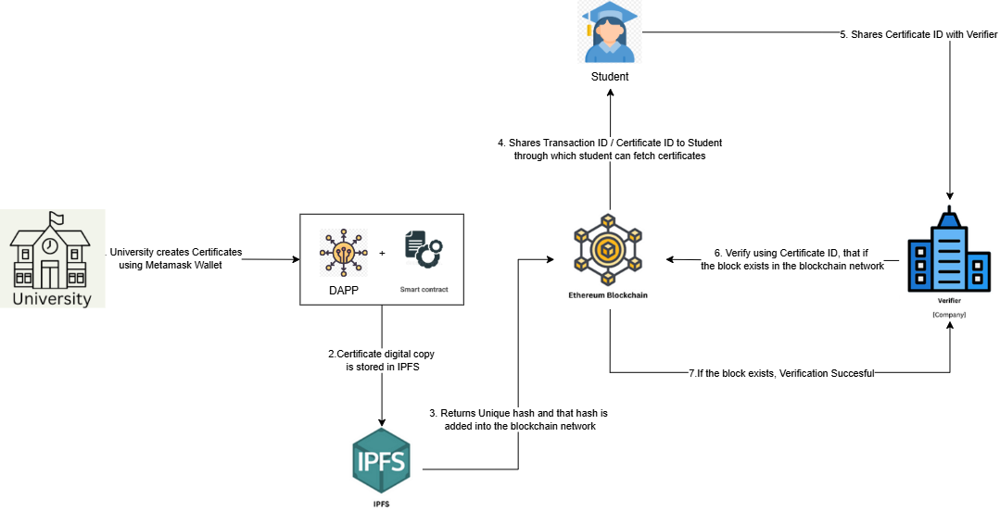
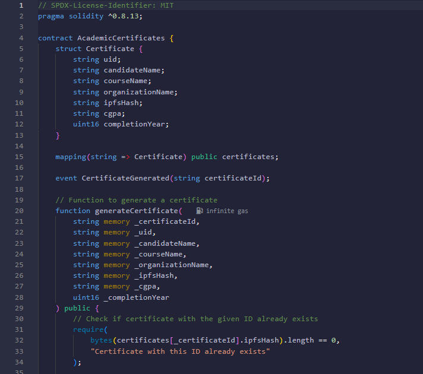
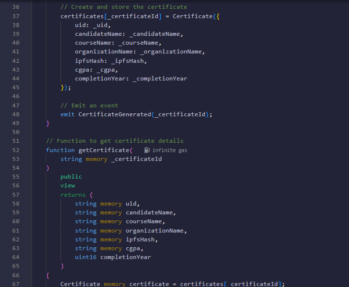
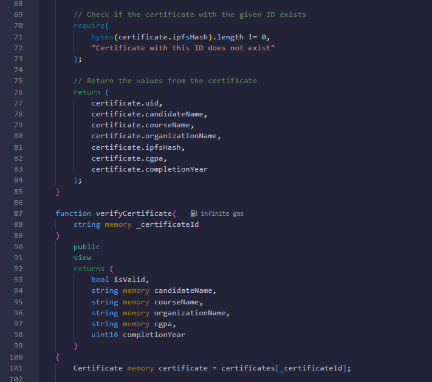
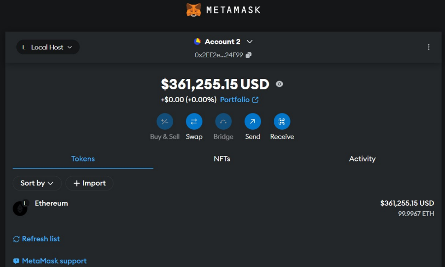
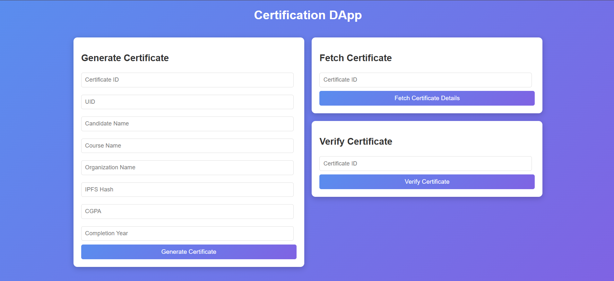

# Academic Certificate Verification using Blockchain Technology

*2025 IEEE International Conference on Contemporary Computing and Communications (InC4)*

DOI: 10.1109/InC465408.2025.11256194

## Authors

Milan Arvind Patel  
Computer Science and Engineering  
IIIT Bhubaneswar  
Odisha, India  
A124005@iiit-bh.ac.in

Srichandan Sobhanayak  
Computer Science and Engineering  
IIIT Bhubaneswar  
Odisha, India  
srichandan@iiit-bh.ac.in

Anita Sahoo  
Computer Science and Engineering  
IIIT Bhubaneswar  
Odisha, India  
C122001@iiit-bh.ac.in

**Abstract**—Verifying certificates is essential for ensuring the authenticity and integrity of academic credentials. Traditional systems are prone to vulnerabilities, including data misuse and forgery, necessitating the adoption of more secure digital solutions. This project leverages blockchain technology on the Ethereum platform, chosen for its secure smart contracts and widespread adoption, and the InterPlanetary File System (IPFS) to provide a decentralized and tamper-proof framework for certificate validation. Blockchain-based hashing techniques are employed to confirm the legitimacy of certificates, while IPFS enables secure off-chain storage of large certificate files. This hybrid approach reduces storage requirements by storing only certificate hashes on-chain while using IPFS for storing large files, ensuring efficiency. The system stores certificate data on IPFS, generating a unique hash recorded on the Ethereum blockchain. By combining Ethereum’s decentralized ledger with IPFS’s distributed file storage, the proposed solution enhances transparency, reduces the risk of forgery, and offers a scalable and efficient method for verifying academic certificates.

## I. INTRODUCTION

In the fast-changing digital environment, the necessity of confirming the legitimacy of credentials—such as academic degrees and professional certifications—has become increasingly important, prompted by the rise in forgery and misrepresentation. This initiative seeks to tackle this issue by utilizing the groundbreaking capabilities of blockchain technology to create a secure and transparent system for validating certificates. By using blockchain to store certificate data, we establish an unchangeable ledger that ensures data integrity and prevents unauthorized modifications, thereby enhancing trust in the validation process. This cutting-edge system streamlines the verification process for educational institutions, employers, and individuals, significantly decreasing the time and effort involved in credential confirmation. Moreover, it boosts overall confidence in the legitimacy of academic and professional qualifications, creating a dependable framework that benefits society by promoting accountability and transparency in credentialing methods. Through this strategy, we aim to transform the credential verification landscape and set a new benchmark of trustworthiness in the digital era. [2], [9]

Traditional methods of certificate validation often present various challenges, including cumbersome procedures, delays, and inherent security vulnerabilities. These conventional processes generally rely on centralized databases that are susceptible to breaches and require extensive manual handling, which can lead to human errors, potential data loss, and increased fraud risk. Typically, the validation process involves a lengthy correspondence with the educational institution or issuing authority, which can be both time-consuming and resource-intensive [11], [13], [23]. As a result, these challenges significantly undermine overall confidence in the validation system, leading stakeholders—such as employers and applicants—to question the reliability of presented credentials.

In stark contrast, blockchain technology provides numerous advantages for the verification of certificates. Its decentralized architecture eliminates the single point of failure associated with traditional systems, thereby enhancing the safety and reliability of stored data. Additionally, the integration of smart contracts enables automatic validation processes, which minimizes the need for human intervention, reducing delays and inconsistencies while accelerating the overall verification timeline [17], [19], [21]. By automating these processes, near-instantaneous verification becomes a reality, representing a significant improvement over existing methods.

Moreover, the inherent transparency provided by blockchain technology enables real-time validation of credentials. This level of openness encourages collaboration among all involved parties—issuers, holders, and verifiers—ensuring that each stakeholder has access to identical, verifiable information. Such shared access greatly enhances trust within the system, as it alleviates concerns regarding the possibility of one party having access to different data than another. By adopting blockchain for the purpose of credential verification, we not only tackle the widespread challenge of counterfeit documents but also significantly bolster the credibility and integrity of both academic and professional qualifications. In our increasingly interconnected global landscape, this approach plays a crucial role, promoting confidence in the credentials presented by individuals and fostering a more reliable atmosphere for education and employment. The result is a more trustworthy framework that benefits everyone involved. [17]

Going Further, the paper is organized into several key sections: Section II: which evaluates existing systems and identifies their limitations; Section III: which cover foundational concepts pertinent to the project; Section IV: which details the design and functionality of the blockchain-based system; Section V: which outlines the tools and platforms employed; Section VI: which emphasizes implementation aspects which includes smart contract and user interaction; Section VII: which wraps up the project with a conclusion on its potential impact and future development opportunities; and at-last references.

## II. LITERATURE SURVEY

Blockchain-Based Academic Certificate Validation** The growing dependence on technology for academic certifications has emphasized the necessity for secure, effective, and tamper-resistant systems. Blockchain technology has emerged as a robust solution to tackle the issues linked to conventional certification processes. This survey offers a summary of research utilizing blockchain for the validation and management of certificates. G. Sethia [24] examined the essential function that academic certificates play in an individual’s life. Their research suggested a framework based on blockchain to improve trust, security, and transparency in the sharing and verification of certificates. By employing Hyperledger Fabric, the system preserves issued certificates that can be verified using details provided by students, effectively addressing the problem of counterfeit certificates. M. Di Pierro (2017) [4], [15] described the fundamental principles of blockchain technology, emphasizing its architecture and hashing techniques. The study included a basic implementation in Python, illustrating blockchain’s capabilities and its potential to create secure systems. T. Nurhaeni et al. (2020) [18] pointed out blockchain’s potential within the educational domain, especially for long-term, tamper-proof storage solutions. Their research adopted both descriptive and analytical methods to investigate how distributed systems and cryptographic techniques can transform certificate management. Raghav et al. (2019) [20] evaluated the shortcomings of existing certification systems and proposed a tamper-proof framework utilizing Hyperledger Fabric and IPFS. By using encryption and hash methods, the suggested model improves the security and authenticity of academic certificates. P. E. Gundgurti et al. (2020) [7] tackled the widespread issue of counterfeit certificates. Their blockchain-based approach preserves certificates as immutable blocks, ensuring they cannot be altered or misused, thereby providing a strong defense against forgery.

T. T. Huynh et al. (2018) [8] introduced the ”UniCert” model, a certification framework based on blockchain that employs UniCoin, a digital currency developed on blockchain technology. This model facilitates cost-effective and secure issuance and verification of academic credentials. B. Duan et al. (2017) [5], [14] investigated the wider applications of blockchain technology in the education sector. Their research stressed the possibility of storing extensive student data as blockchain records, which could be applied for evaluations such as job competency assessments. I. Afrianto et al. (2020) [1] created a system for saving certificates on a public blockchain using smart contracts. The model includes IPFS for secure and distributed storage, thereby enhancing both access and security. A. Gayathiri et al. (2020) [6] proposed a system based on a mobile application for storing and validating educational certificates. Their framework transforms certificates into a digital form, computes their hash using chaotic algorithms, and securely stores them on the blockchain. Z. Wang et al. (2022) [26] presented a blockchain-based model to improve the transparency and revocation processes for SSL/TLS certificates. The system addresses vulnerabilities found in traditional certificate issuance methods, thereby enhancing overall security.

J.-C. Cheng et al. (2018) [3] concentrated on the use of blockchain and smart contracts for creating and validating digital certificates. Their system generates QR codes for certificates archived on the blockchain, thereby simplifying the verification of authenticity for users. D. Liu et al. (2019) [12] proposed a blockchain-driven solution for certificate storage and validation, underscoring the decentralized aspect of the system to prevent tampering and eliminate single points of failure. D. Vujičić et al. (2018) [22], [25] explored the capabilities of smart contracts on the Ethereum platform and their use in issuing and verifying academic certificates. Their study illustrated how blockchain enhances both transparency and security. S. S. Kumari et al. (2018) [10] suggested a system that assigns QR codes and serial numbers to digital certificates. This approach can be utilized for secure sharing and verification, thus guaranteeing the authenticity of the certificates. S. S. More et al. (2021) [16] emphasized the application of blockchain’s decentralized peer-to-peer network for document storage and verification. Their system ensures trust, immutability, and transparency in the management of certificates.

This survey highlights the transformational possibilities of blockchain in validating academic certificates, providing secure, transparent, and tamper-proof solutions for educational institutions.

## III. PRELIMINARIES

The figure 1 tells us about how Blockchain technology provides a secure, transparent, and immutable framework that removes the necessity for centralized control. Transactions are validated through a consensus achieved within a distributed network of nodes, ensuring both data integrity and user anonymity. This decentralized architecture is particularly well-suited for applications that demand strong authentication and transparency, such as verifying academic credentials or facilitating financial transactions.

**Core Components of Blockchain:**

1. Nodes: In a blockchain network, each participant is referred to as a node. These nodes are integral to the system as they each maintain their own copy of the distributed ledger. Their primary responsibilities include verifying transactions to ensure they are legitimate and consistent across the entire blockchain. This decentralized nature allows for greater security and transparency within the network.

*Fig. 1. Basic idea of how blockchain works.*

2. Transactions: Transactions represent the fundamental units of blockchain operations, encapsulating essential information such as the transfer of assets, changes in ownership titles, and the corresponding pricing details. Before any transaction is added to the blockchain, it undergoes a rigorous verification process, ensuring that only valid transactions are propagated to all nodes within the network.

3. Blocks: A block is a structured grouping of validated transactions, functioning as a data container within the blockchain. Each block comprises not only these transactions but also the cryptographic hash of the preceding block. This linkage forms a secure chain between blocks, preventing tampering and maintaining the chronological order of all recorded events. Additionally, blocks utilize Merkle Trees to efficiently organize transactions, enabling quick verification and ensuring data integrity.

4. Chain: The blockchain itself is an organized series of these blocks, each secured through advanced cryptographic hashes. This security mechanism safeguards the integrity of the data, making it nearly impossible to alter any information once it has been added to the chain. As a result, the blockchain establishes a trustworthy and immutable record of all transactions.

5. Miners: Specialized nodes, known as miners, perform a critical function within the blockchain ecosystem. They validate transactions by solving complex computational puzzles, a process that is essential for maintaining the network’s security and integrity. In return for their computational efforts and contributions to the network’s stability, miners are rewarded with cryptocurrency, providing an incentive for their participation.

6. Consensus Mechanism: This component is a set of protocols that establishes agreement among nodes regarding the legitimacy of transactions and blocks. Various frameworks, such as Proof of Work (PoW) and Proof of Stake (PoS), dictate how this consensus is achieved, ensuring that all participating nodes adhere to a unified standard for transaction validation.

**Additional Features:**

Smart Contracts: These are innovative agreements that are coded and stored directly on the blockchain. Smart contracts automatically execute transactions and enforce the terms of agreements once predetermined conditions are fulfilled, thereby reducing the need for intermediaries and increasing efficiency.

Gas: In the context of blockchain, gas represents a quantified measure of the computational effort necessary to execute transactions or smart contracts. It serves a dual purpose: allocating network resources and validators for their efforts as they process and confirm transactions, ensuring the system remains functional and efficient. These core components and characteristics underpin the secure and decentralized operation of blockchain technology, making it a valuable solution for a range of applications, including financial systems, identity verification, and academic credentialing.

## IV. PROPOSED MODEL

This part outlines the approach of the suggested system, providing details on the design of the system and its stakeholders which includes University, Students, and Verifiers. The system is organized to enhance the process of issuing and verifying certificates through the use of blockchain technology, guaranteeing security, transparency, and reliability.

### A. System Design

The suggested system utilizes blockchain technology to establish a decentralized and immutable platform for validating certificates. It is built on the Ethereum platform and functions via the Ethereum Virtual Machine (EVM). By integrating smart contracts with cryptographic hashes, the system guarantees that certificates are securely stored and can be verified effortlessly. The process is classified into three main stages: issuance of certificates, sharing of certificates, and their verification.

*Fig. 2. Architecture of the Proposed Certificate Verification Model*

The figure 2 suggests a model that presents a certificate verification system based on blockchain technology that guarantees the authenticity, security, and transparency of data. This system utilizes the Ethereum blockchain along with IPFS (InterPlanetary File System) to efficiently manage the creation, storage, and verification of digital certificates.

**Step-by-Step Workflow:**

Step 1. University Generates Certificate : The process starts with the university or the authority responsible for issuing certificates generates certificate using metamask wallet. The university can issue digital certificates to students who satisfy the necessary academic criteria. These certificates include essential information, such as the student’s name, certificate ID, and academic qualifications.

The issuance procedure is handled via a Decentralized Application (DApp), which interacts with Ethereum smart contracts. These smart contracts guarantee that the data is recorded securely and permanently on the blockchain. The university employs the DApp to enter certificate information and activate the smart contract for storage of the certificate.

Step 2. Storage on IPFS: The digital version of the issued certificate is uploaded to IPFS, a decentralized file storage system. IPFS distributes the certificate across a network of nodes, ensuring that the data is secure from tampering and remains accessible. After successful storage, IPFS creates a unique hash that acts as a fingerprint for the uploaded certificate.

Step 3. Blockchain Hash Storage: The hash created by IPFS is subsequently recorded on the Ethereum blockchain via the smart contract. This action ensures that the data related to the certificate remains immutable by linking it to a transaction in the blockchain. Once recorded, the details of the certificate, along with the hash, are securely documented in the blockchain network.

Step 4. Distribution to Students: After the successful registration of the certificate, the system/university provides the student with a transaction ID or Certificate ID. The transaction ID serves as a unique identifier for the certificate stored on the blockchain, while the Certificate ID facilitates easy access to this information for verification. The student can share either the transaction ID or the certificate ID with verifiers, such as prospective employers or academic institutions, to validate the authenticity of their credentials.

Step 5. Verifier Verifies Certificate In Blockchain: When a verifier, like a business, receives the transaction ID or Certificate ID from the student, they can use it to query the blockchain network. The verifier accesses the blockchain to verify whether the transaction ID or the hash associated with the certificate is present. In doing so, they ensure that the certificate details correspond with those securely recorded on the blockchain.

Step 6. Validation and Result: If the blockchain verifies that the hash linked to the certificate data exists, the verification process is considered successful. The verifier can be confident that the certificate is authentic and has not been altered. Conversely, if the hash is absent or does not match, the verification fails, indicating potential forgery or modification.

**Key Features of the Model:**

Security Utilizing the Ethereum blockchain ensures that the record of the certificate is immutable, making unauthorized alterations impossible.

Decentralized Storage: IPFS provides an effective means of storing and retrieving certificates, reducing the risk of failures or hacks associated with a central server.

This architecture adeptly combines the advantages of blockchain technology and decentralized storage to tackle the prevalent issues of certificate forgery and inefficiency in traditional verification systems.

## V. TECHNOLOGY USED

To establish a secure and transparent certificate validation system, the proposed solution leverages the Ethereum blockchain, an open-source platform designed for decentralized applications. Students and verifiers can upload and validate academic certificates by integrating MetaMask, a cryptocurrency wallet, with the certificate validation system. This ensures data integrity, user authentication, and seamless interaction with the blockchain.

The technological requirements for the proposed system are outlined as follows:

**1. Ethereum:**

A blockchain platform for decentralized and immutable smart contract execution.

**2. Solidity:**

To write smart contracts that reference IPFS hashes for certificate data storage.

**3. IPFS Storage:**

IPFS Nodes are used to store and retrieve certificate files. You can run your own IPFS node or use public IPFS gateways like Infura’s IPFS or Pinata for managing file storage.

**4. Development Frameworks:**

Remix IDE: A browser-based IDE for writing, testing, and deploying smart contracts.

Truffle Suite: A development framework for building, testing, and deploying Ethereum smart contracts.

Ganache: A personal blockchain for simulating Ethereum networks, used for local testing and debugging.

Visual Studio Code (VS Code): A versatile code editor with extensions for Solidity and blockchain development.

**5. IPFS Integration Libraries:**

IPFS HTTP Client: A JavaScript library for interacting with IPFS nodes from your application.

Web3.js/Ethers.js: To link your Ethereum smart contracts with the IPFS-stored data.

**6. MetaMask:**

For users to sign blockchain transactions and connect their Ethereum wallets.

**7. Frontend Technologies:**

Javascript: For building the user interface where users (students and verifiers) interact with the system.

HTML/CSS: For structuring and styling the web application.

**8. Backend Technologies:**

Node.js and Express.js: To build an API that interacts with both Ethereum and IPFS.

9. Hash Verification: SHA-256 Hashing: Ensures data integrity by verifying that the content stored in IPFS matches the hash stored on the blockchain.

## VI. PROOF OF IMPLEMENTATION

### A. Smart Contract

*Fig. 3. AcademicCertificates.sol pg-1*

*Fig. 4. AcademicCertificates.sol pg-2*

The figure 7 shows us the front-end of the D-App. The D-App communicates with the smart contract certificate.sol given in figures 3, 4, 5 to generate and verify certificates, while the Metamask wallet shown in figure 6 facilitates secure transactions that require confirmation for the transaction to proceed.

### B. Metamask

### C. DApp

The decentralized application (D-App) shown in figure 7 enhances academic certificate management by allowing Universities to efficiently create student certificates, reducing problems like forgery and lost diplomas, and improving the reliability of academic records.

*Fig. 5. AcademicCertificates.sol pg-3*

*Fig. 6. Metamask Wallet*

For Students, The D-app offers easy access to their certificates via a unique certificate ID, simplifying the retrieval process for job applications and further education.

Verifiers, such as employers and educational institutions, can efficiently authenticate academic certificates through the D-App. By using the student certificate ID, they can confirm the certificate’s authenticity and also view the student’s performance in the course.

In summary, the D-App emerges as an innovative solution specifically designed to address the unique needs and challenges encountered by universities, students, and verifiers alike.

Smart Contract for the D-app can be reffered at: https://github.com/milanpatel09/ Academic-Certificate-Verification-in-Blockchain-Technology

## VII. CONCLUSION

The blockchain-based academic certificate verification system enhances the reliability and efficiency of validating educational credentials. By integrating Ethereum blockchain with the InterPlanetary File System (IPFS), it creates a decentralized, tamper-resistant method for storing certificate information. Unique cryptographic hashes on the blockchain ensure data integrity and facilitate real-time validation without requiring excessive storage. Smart contracts streamline the process, reducing manual input and speeding up verification times. This approach addresses issues like data misuse, forgery, and delays typical of traditional systems, while its decentralized design improves security by eliminating single points of failure. The transparency provided by blockchain fosters trust among stakeholders. This research has demonstrated the potential of blockchain technology, specifically using IPFS, for academic certificate validation. Although existing implementations predominantly rely on proof-of-work models, Future efforts will focus on integrating proof-of-stake into the validation process using Ethereum 2.0 blockchain, which will align with the goal of creating a scalable, efficient, and environmentally conscious system.

*Fig. 7. D-App*

## REFERENCES

[1] Irawan Afrianto and Yayan Heryanto. Design and implementation of work training certificate verification based on public blockchain platform. In 2020 Fifth International Conference on Informatics and Computing (ICIC), pages 1–8, 2020.

[2] F. Bond, F. Amati, and G. Blousson. Blockchain, academic verification use case, Aug 2015. Online.

[3] Jiin-Chiou Cheng, Narn-Yih Lee, Chien Chi, and Yi-Hua Chen. Blockchain and smart contract for digital certificate. In 2018 IEEE International Conference on Applied System Invention (ICASI), pages 1046–1051, 2018.

[4] Massimo Di Pierro. What is the blockchain? Computing in Science Engineering, 19(5):92–95, 2017.

[5] Bin Duan, Ying Zhong, and Dayu Liu. Education application of blockchain technology: Learning outcome and meta-diploma. In 2017 IEEE 23rd International Conference on Parallel and Distributed Systems (ICPADS), pages 814–817, 2017.

[6] A. Gayathiri, J. Jayachitra, and S. Matilda. Certificate validation using blockchain. In 2020 7th International Conference on Smart Structures and Systems (ICSSS), pages 1–4, 2020.

[7] Padmavati E. Gundgurti, Kranthi Alluri, Poornima E Gundgurti, Sai Harika K., and G. Vaishnavi. Smart and secure certificate validation system through blockchain. In 2020 Second International Conference on Inventive Research in Computing Applications (ICIRCA), pages 862– 868, 2020.

[8] Trong Thua Huynh, Trung Tru Huynh, Dang Khoa Pham, and Anh Khoa Ngo. Issuing and verifying digital certificates with blockchain. In 2018 International Conference on Advanced Technologies for Communications (ATC), pages 332–336, 2018.

[9] Rafah Amer Jaafar, Saad Najim Alsaad, and Mohammed Naji Al-Kabi. Educational certificate verification system: Enhancing security and authenticity using ethereum blockchain and ipfs. Al-Mustansiriyah Journal of Science, 35(1):78–87, Mar. 2024.

[10] S. kumari and Saveetha Dhandapani. Blockchain and smart contract for digital document verification. International Journal of Engineering Technology, 7:394, 09 2018.

[11] E. Leka, E. Kordha, and K. Hamzallari. Towards an ipfs-blockchain based authentication/management system of academic certification in western balkans. In 2022 45th Jubilee International Convention on Information, Communication and Electronic Technology (MIPRO), pages 1448–1453, 2022.

[12] Dongwei Liu and Xiaojin Guo. Blockchain based storage and verification scheme of credible degree certificate. In 2019 2nd International Conference on Safety Produce Informatization (IICSPI), pages 350–352, 2019.

[13] Devdoot Maji, Ravi Singh Lamkoti, Hitesh Shetty, and Bharati Gondhalekar. Certificate verification using blockchain and generation of transcript. INTERNATIONAL JOURNAL OF ENGINEERING RESEARCH & TECHNOLOGY (IJERT), 10(03), March 2021.

[14] Soubhagya Ranjan Mallick, Srichandan Sobhanayak, and Rakesh Kumar Lenka. Blockchain-enhanced iot ecosystem for healthcare: Transformative potentials, applications, challenges, solutions, and future perspectives. Computers & Industrial Engineering, 197:110538, 2024.

[15] Bhabendu Kumar Mohanta, Debasish Jena, Soumyashree S Panda, and Srichandan Sobhanayak. Blockchain technology: A survey on applications and security privacy challenges. Internet of Things, 8:100107, 2019.

[16] Shraddha S More, Niraj Patel, Sukaji Parab, and Sushil Maurya. Blockchain based tamper proof certificates. In Proceedings of the International Conference on Smart Data Intelligence (ICSMDI 2021), 2021.

[17] Sumaiya Islam Mouno, Tasfia Rahman, Arunangshu Mojumder Raatul, and Nafees Mansoor. Certiblock: The exemplary utilization of blockchain for the rigorous validation of academic certificates. In 2023 26th International Conference on Computer and Information Technology (ICCIT), pages 1–6, 2023.

[18] Tuti Nurhaeni, Indri Handayani, Frizca Budiarty, Desy Apriani, and Po Abas Sunarya. Adoption of upcoming blockchain revolution in higher education: Its potential in validating certificates. In 2020 Fifth International Conference on Informatics and Computing (ICIC), pages 1–5, 2020.

[19] Manjula K Pawar, Prakashgoud Patil, Ridham Sawhney, Prem Gumathanavar, Shraddha Hegde, and Kavya Maremmagol. Performance analysis of e-certificate generation and verification using blockchain and ipfs. In 2022 International Conference on Inventive Computation Technologies (ICICT), pages 345–350, 2022.

[20] Raghav, Nitish Andola, Rakhi Verma, S. Venkatesan, and Shekhar Verma. Tamper-proof certificate management system. In 2019 IEEE Conference on Information and Communication Technology, pages 1–6, 2019.

[21] Anita Sahoo, Rakesh Kumar Lenka, Soubhagya Ranjan Mallick, Shantilata Palai, Manas Mukul, and Rabindra K. Barik. Dual-encrypted privacy preservation in blockchain-enabled iot healthcare system. In 2023 International Conference on Computer, Electronics Electrical Engineering their Applications (IC2E3), pages 1–6, 2023.

[22] Anita Sahoo, Rakesh Kumar Lenka, Soubhagya Ranjan Mallick, and Pradyumna Kumar Tripathy. Blockchain applications in iot-based healthcare system- a review. In 2023 OITS International Conference on Information Technology (OCIT), pages 303–308, 2023.

[23] Anita Sahoo and Srichandan Sobhanayak. Ebh-iot: Energy-efficient secured data collection and distribution of electronics health record for cloud assisted blockchain enabled iot based healthcare system. Journal of Industrial Information Integration, 42:100702, 2024.

[24] Garima Sethia, Sambarapu Namratha, Srikanth H, and Sreeja C S. Academic certificate validation using blockchain technology. In 2022 International Conference on Trends in Quantum Computing and Emerging Business Technologies (TQCEBT), pages 1–5, 2022.

[25] Dejan Vujičić, Dijana Jagodić, and Siniša Ranić. Blockchain technology, bitcoin, and ethereum: A brief overview. In 2018 17th International Symposium INFOTEH-JAHORINA (INFOTEH), pages 1–6, 2018.

[26] Ze Wang, Jingqiang Lin, Quanwei Cai, Qiongxiao Wang, Daren Zha, and Jiwu Jing. Blockchain-based certificate transparency and revocation transparency. IEEE Transactions on Dependable and Secure Computing, 19(1):681–697, 2022.
